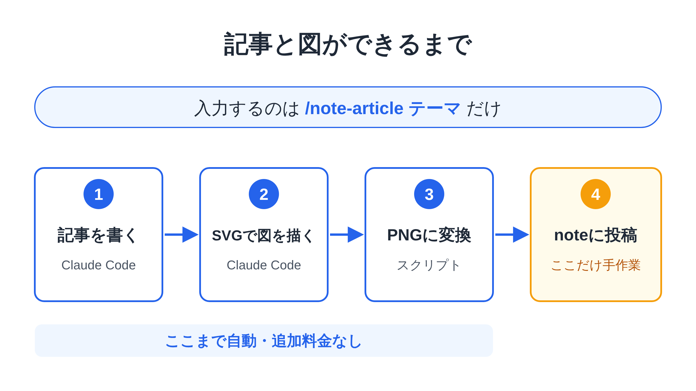
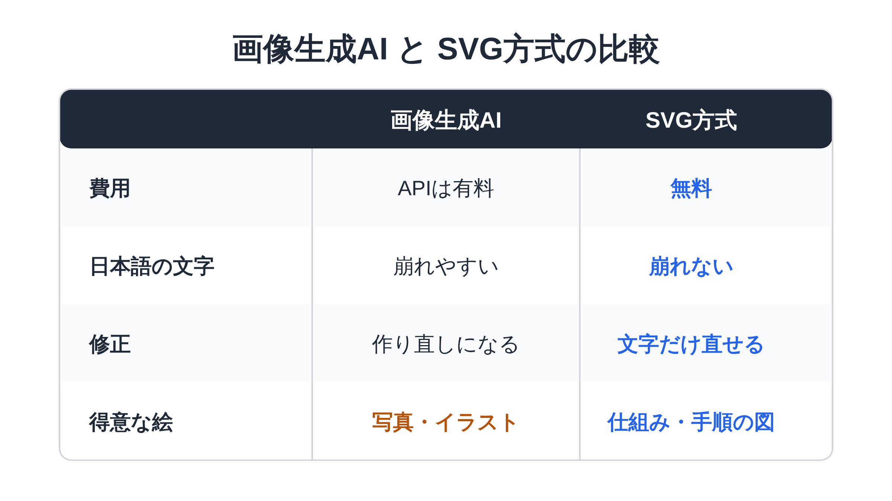

# 無料で解説図つきのnote記事を自動で作る ― Claude Codeだけで完結する仕組み

note の記事を書くとき、いちばん時間がかかるのは「図」ではないでしょうか。
文章は書けても、仕組みを説明する図を毎回作るのは大変です。

そこで、**Claude Code に記事と図の両方を作らせる仕組み**を作ってみました。画像生成AIは使わないので、追加料金はかかりません。

## 全体の流れ

やることは、Claude Code に `/note-article テーマ` と入力するだけです。

<!-- FIGURE: fig1-workflow | /note-article 入力 → 記事を書く → SVGで図を描く → PNGに変換 → noteに投稿、の4ステップの流れ図 -->

1. Claude Code が記事の本文を書く
2. 図を入れたい場所に「ここに図」という目印を置き、図を SVG（文字と図形で描く画像形式）で描く
3. スクリプトが SVG を PNG に変換して、記事に埋め込む
4. 最後に、本文と PNG を note に投稿する（ここだけ手作業）

## 画像生成AIとの違い

ChatGPT などの画像生成AIでも図は作れます。ただ、解説図に関しては「図形で描く」方式のほうが向いていると感じています。

<!-- FIGURE: fig2-compare | 画像生成AIとSVG方式の比較表（費用・日本語の文字・修正のしやすさ・得意な絵） -->

特に大きいのが **日本語の文字が崩れない** ことです。画像生成AIは日本語の文字を崩しやすく、ラベルの多い解説図では使いにくいことがあります。
一方で、写真風やイラスト風の絵は画像生成AIの得意分野です。用途で使い分けるのがおすすめです。

## まとめ

- Claude Code だけで、記事と解説図をまとめて作れる
- 追加料金なし、日本語の文字もきれい
- note への投稿だけは手作業

図づくりの手間が減ると、記事を書くハードルがぐっと下がります。
